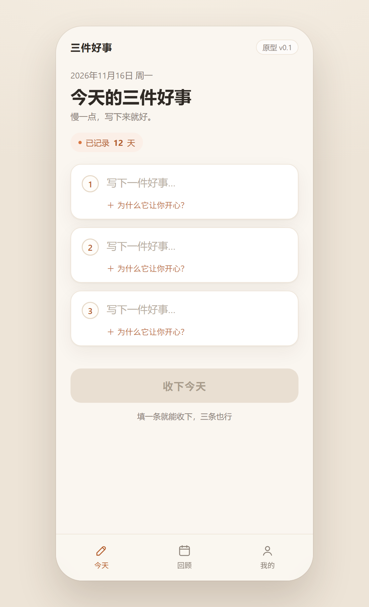
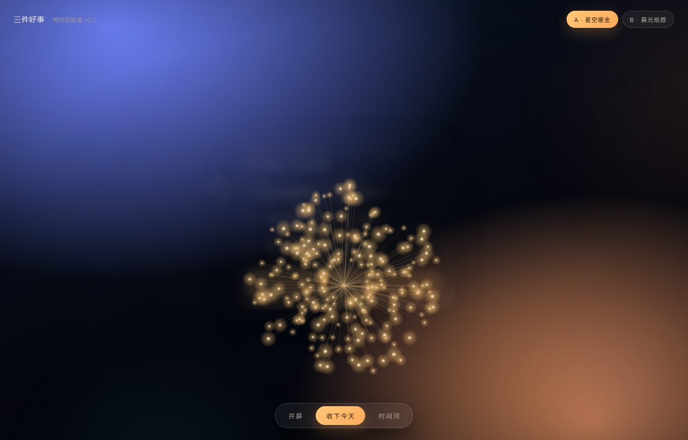
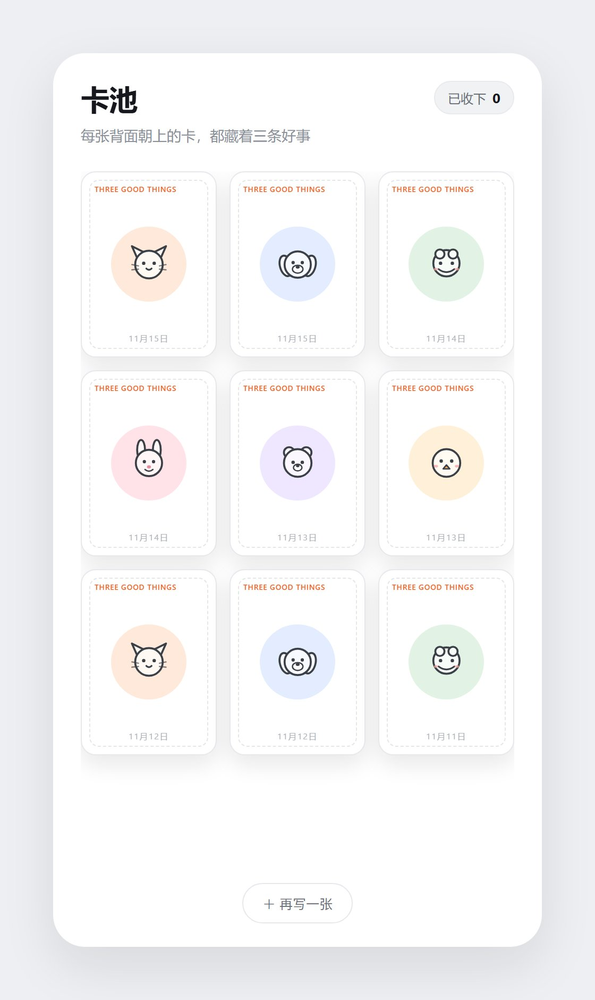

# 三件好事 · Three Good Things

> 每天记下三件好事，慢慢看见生活里的光。

一个「三件好事」记录 App。想法来自积极心理学里经典的感恩练习 **Three Good Things**（Seligman）：每天睡前写下当天发生的三件好事，并简单说明它为什么让你开心。

**当前状态**：已定 Web 形态 + 静态原型（v0.1），接下来用 Vue 3 工程化实现。

## 原型

静态原型在 [`docs/index.html`](docs/index.html)，**双击用浏览器打开**即可（页面按手机宽度设计，桌面端会显示手机外壳）。



| 页面 | 说明 |
| --- | --- |
| [今天（空）](docs/preview-today.png) | 默认打开就能写，填 1 条就能保存 |
| [今天（填了）](docs/preview-filled.png) | "为什么它让你开心" 展开状态 |
| [回顾](docs/preview-review.png) | 日历点亮 + 随机翻一条 |
| [我的](docs/preview-mine.png) | 提醒、导出、清空数据 |

## 已定的选择

- 形态：**Web（H5）**，不做小程序；以后要小程序可以用 uni-app 迁大部分 Vue 代码
- 前端：**Vue 3 + Vite + TypeScript**，CSS 手写（不引 UI 库）
- 首版存储：**localStorage** + 导出 JSON / Markdown，先不做账号
- 后端：**Go**，第二版再加（接口按 REST 设计，存储层会单独抽象）
- 风格：暖色手账感（暖白 `#FAF6F0`、主色 `#D97742`）

## 特效实验室（v0.2）

[`experiments/effects-lab/`](experiments/effects-lab/) 是纯手写 canvas / CSS 的动效试验场（不引第三方库），用来对比「自己造」和之后要接入的现成方案（GSAP / Lottie / Rive / Three.js）。

| 场景 | 效果 |
| --- | --- |
| 开屏 | 极光渐变 + 光尘漂浮，标题逐字浮现 |
| 收下今天 | 光点爆散 → 收束成三颗星 → 结果卡浮现（带 Web Audio 合成音效） |
| 时间河 | 滚轮切换日子卡片，3D 景深 + 星点流动 |

右上角可切换两套配色（A 星空暖金 / B 晨光纸感）。本地打开 `experiments/effects-lab/index.html` 即可；`#give&frame=0.6` 这类 hash 可定格某个动画时刻，方便截图。



## 卡牌社区 demo（v0.2 · 白底版）

[`experiments/card-flow/`](experiments/card-flow/) 把「三件好事」做成可以收集的卡：**写三条 → 生成卡 → 投篮把卡投进篮筐 → 卡背面朝上进卡池 → 点开翻牌看内容**。

- 视觉复刻了「Upload files + 篮球」那套设计：白底、浅灰虚线框、橙色描边篮板、灰线篮网、底部卡片 + 上传进度条
- 交互：拖拽卡片投篮（或点「自动投」）、橙色光点拖尾、篮网晃动 + 音效、卡池 3D 翻牌
- 卡背是原创小动物（手绘 SVG，可整组替换素材，不碰版权）
- 本地打开 `experiments/card-flow/index.html`；`#wall&flip=0` 直接看翻牌、`#shoot&frozen=0.6` 定格飞行瞬间



## 功能草案

| 版本 | 功能 |
| --- | --- |
| MVP | 今天写 1–3 条 + 可选"为什么"；按日时间线；日历回顾；导出；本地存储 |
| 第 2 版 | 随机回顾 / 那年今日；统计；标签；PWA 提醒；深色模式 |
| 第 3 版 | Go 后端 + 账号同步；年度好事报告 |

## 目录结构

```
docs/
  index.html        静态原型（v0.1）
  preview-*.png     原型截图
  design.md         产品构思、待决问题、里程碑
```

## 开发

技术栈确定后补充（Vue 工程化）。

## 许可

[MIT](LICENSE)
